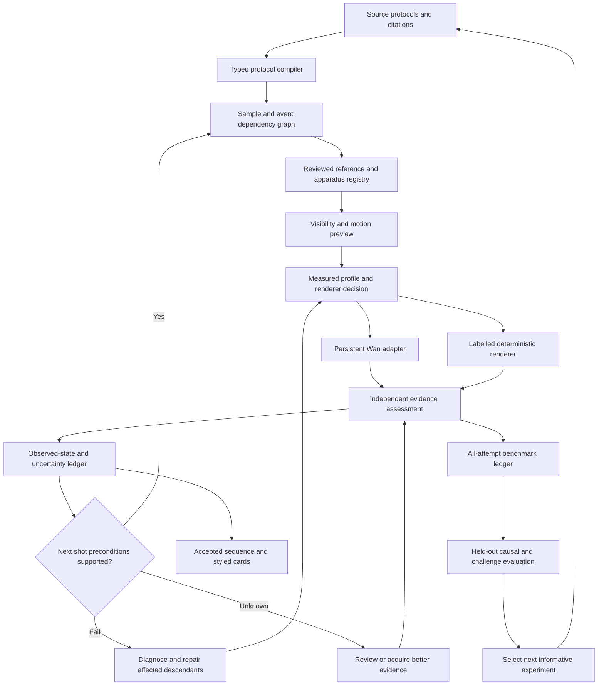

# Five architecture design cycles for the educational-video system

Date: 10 November 2026. Branch: feature/persistent-wan-worker.

These are five completed design-and-critique cycles, not five GPU experiments or
five automatic retries. Each cycle responds to the previous design's remaining
weakness. The target architecture below is proposed; existing components are
explicitly distinguished from integrations that still need implementation.

## What is actually available

The current batch has 23 draft pilot configurations, 18 raster references and
links to 11 canonical chemistry records. These are excerpts, not 23 independently
validated full experiments. Physics source review remains blocked on the promised
manual. Image hashes and protocol-step hashes protect identity, not scientific
truth. The latest CPU checks passed 45 pipeline tests and five dataset tests;
plan/card/preflight cells ran for all pilots. No new accepted end-to-end GPU run
establishes a science-quality or speed gain.

Implemented building blocks include source quantities, material budgets, state
tracks, final/reviewed handoffs, hash-bound human evidence, visibility annotations,
bounded repair, dependency invalidation, circuit rendering, benchmark capture and
an offline measured-profile selector. The default pilot loader still emits empty
science entity lists and temporal order arrays. Observe/warn runs deliberately
permit unresolved review; they must not be presented as scientifically accepted.

PROJECT_HANDOFF.md and parts of RESEARCH_CHECKLIST.md describe older snapshots.
Use the notebook's actual pinned commits, current code and run manifests for
execution provenance. Do not treat old documentation as target-hardware results.

## Cycle 1: Compile experiments before rendering

**Problem.** Prompt text flattens quantities, entities, separate samples, time and observations.

**Design hypothesis.** A typed protocol compiler prevents contradictory shots before spending GPU time.

**Changes.** source-resolved protocol intermediate representation; persistent apparatus and sample IDs; explicit contact and event dependencies; source quantity intervals and unknowns; separate process time, generated time and presented time.

**Alternatives considered.** Prompt expansion alone: cheap but does not enforce invariants. Train a new science model immediately: costly and unsupported by the current reviewed data.

**Adversarial thought experiment.** Try compiling repeated aliquots, stock preparations and missing doses; reject accidental dose multiplication and conflated samples.

**Experiment needed.** Compare same source plans with and without compilation; count invalid plans and independently reviewed procedural errors.

**If this succeeds.** A dependency graph can drive reusable references and grounded handoffs.

**Why another iteration is needed.** A correct requested state still does not prove the video achieved it.

## Cycle 2: Make continuity evidence-dependent

**Problem.** Final-frame similarity does not establish action completion, identity or volume continuity.

**Design hypothesis.** An uncertainty-aware state ledger prevents unsupported scientific state from propagating.

**Changes.** desired, observed and accepted state kept separate; entity-scoped predicates with evidence intervals; three-valued pass/fail/unknown state; hash-bound source/reference/video/reviewer lineage; consumer-specific handoff preconditions.

**Alternatives considered.** Use the last frame unconditionally: cheap but can propagate a failed action. Trust a VLM numeric score: not calibrated for these chemistry claims.

**Adversarial thought experiment.** A plausible final frame hides a missing pour; a blurred meniscus is unknown rather than proof of volume.

**Experiment needed.** Compare final-frame chaining with evidence-qualified chaining at matched compute; measure transition precision, false acceptance and full-sequence success.

**If this succeeds.** Explicit uncertainty identifies which next observation or repair would actually help.

**Why another iteration is needed.** Reviewing every predicate on every frame can dominate total cost.

## Cycle 3: Choose evidence and rendering before expensive generation

**Problem.** Correctness checks may be too costly or impossible in an unreadable camera view.

**Design hypothesis.** Cheap visibility and motion previews can eliminate unjudgeable shots and route exact content to deterministic renderers.

**Changes.** image-hash-bound target regions and occlusion status; projected visibility checks at actual output and fallback resolution; lightweight candidate motion/contact previews; renderer capabilities for photoreal footage, calibrated overlays and labelled diagrams; human review escalation for unsupported semantic checks.

**Alternatives considered.** Increase resolution everywhere: memory cost without guaranteed observability. Automatically replace failed footage with diagrams: changes the task and can contaminate comparisons.

**Adversarial thought experiment.** A rim hides paper contact, a low-area fallback makes a drop invisible, or an explanatory animation is mistaken for a real observation.

**Experiment needed.** Visibility-only and preview-only ablations; compare time lost to rejected shots, judgeability and annotation labour.

**If this succeeds.** Renderer and visibility requirements become constraints for a measured compute scheduler.

**Why another iteration is needed.** A good preview does not guarantee that the unconstrained Wan output follows its trajectory.

## Cycle 4: Spend compute on accepted scientific progress

**Problem.** Uniform clips, unmeasured optimizations and repeated expert loading waste limited memory and wall time.

**Design hypothesis.** A conservative scheduler can choose among measured feasible profiles and repair only scientifically affected descendants.

**Changes.** hardware/model/version-specific profile registry; uncertainty and visibility constrained profile selection; per-sample sequential execution with optional scheduling across independent jobs; failure-type-specific repair and descendant invalidation; all-attempt compute ledger and cold/warm/resume distinction; separate model-adapter experiments for longer native generation.

**Alternatives considered.** Batch all dependent clips by expert: violates decoded-state dependencies. Always lower resolution and upscale: may erase a decisive scientific detail. Enable every cache/kernel/offload option at once: attribution and feasibility become unclear.

**Adversarial thought experiment.** A warm cache profile is used for a cold session, an OOM fallback hides a target, or a cheaper profile increases rerenders.

**Experiment needed.** Matched wall-time and matched-attempt comparisons against the fixed safe_2s baseline; record VRAM, host RAM, disk, cache hits and all repair cost.

**If this succeeds.** A measured quality/cost frontier can support active selection of the next experiment.

**Why another iteration is needed.** The policy can exploit an incomplete verifier or improve easy clips while failing unseen families.

## Cycle 5: Make the system challenge itself and learn what to test next

**Problem.** Generator and verifier can share misconceptions; apparent gains may reflect cherry-picking or leaked templates.

**Design hypothesis.** Independent adversarial/causal evaluation plus family-held-out tests reveals real scientific progress and guides subsequent development.

**Changes.** expert-labelled wrong-order, missing-action, wrong-target and duplicate-apparatus challenges; source-validated causal pairs with no prompt/reference contradictions; blinded external review and reviewer calibration; family-level holdouts, paired seeds and complete attempt manifests; separate photoreal and hybrid evaluation tracks; active experiment selection by expected information gain per total cost; later misconception and retention study.

**Alternatives considered.** Publish one aggregate realism percentage: hides procedural failure. Let one model generate and grade its own answers: shared failure modes. Treat every pilot ID as an independent experiment: pseudoreplication from reused sources and images.

**Adversarial thought experiment.** A verifier accepts a beautiful incorrect clip, a causal pair changes several conditions, or a policy overfits the evaluation set.

**Experiment needed.** Freeze evaluation families and scoring before policy tuning; report false acceptance, coverage, sequence success and costs with uncertainty.

**If this succeeds.** A reusable source/evidence dataset, calibrated decision policy and curriculum-aware generation research programme.

**Why another iteration is needed.** Expert disagreement, limited sources, renderer domain shift and scarce GPU evidence remain; further claims depend on actual experiments.

## Converged architecture

The graph executes over a finite DAG with explicit budgets and terminal states;
the diagram's feedback arrows do not authorize unbounded retries. Source gaps
return to specification/review, not an endless video-generation loop.

### Interfaces that make the architecture concrete

| Boundary | Proposed data | Required behaviour |
|---|---|---|
| Protocol compiler | source IDs/pages/hashes; apparatus/sample IDs; atomic actions; allowed contacts; event edges; dose intervals; unknown fields | Do not turn stock volumes into additions or qualitative endpoints into invented mL |
| State ledger | entity ID; predicate; desired value; observed evidence; pass/fail/unknown; reviewer; video/contract hash; validity interval | Intended outcomes never become observations; unknown stays unknown |
| Transfer event | origin and destination sample; amount and units; source evidence; physical event interval | Track donor and receiver separately; additivity, evaporation and displacement require explicit assumptions |
| Handoff decision | producer hash; consumer preconditions; frame/time; required event evidence; unresolved predicates | A final image can support appearance but cannot prove the preceding procedure occurred |
| Profile registry | model/checkpoint/code/package hashes; hardware; dimensions; native frames; cache state; wall time; device/host memory; outcome | Reject stale/incompatible profiles; account for fallback resolution and cold startup |
| Renderer request | desired observation; method capabilities; quantitative geometry; reference; visible/model distinction | Diagram substitution is explicit and evaluated in its own track |
| Failure record | category; evidence; affected predicates and descendants; proposed intervention; time/attempt budget | Retry model errors only when useful; source gaps and unjudgeable shots need different interventions |
| Attempt record | inputs, seed, profile, all outputs/rejections, review status, wall/GPU time and raw metric artifacts | Failed and rejected attempts remain in denominators |

Use symbolic/interval amounts when the source supplies ranges. Maintain separate
qualitative appearance and quantitative volume fields: a pixel meniscus is not mL
without vessel/camera calibration. For nested apparatus, the inner sample and outer
bath need separate persistent IDs. This directly addresses the Fehling bath and
filter/receiver failure modes that one generic sample track cannot fully describe.

### How this attacks the observed weaknesses

| Observed problem | Target mechanism | What remains uncertain |
|---|---|---|
| Clear sample becomes white | Source-conditioned appearance predicate, phase distinction, whole-sample evidence | Need a calibrated reviewer; text constraints alone are insufficient |
| Equal additions, overflow and level reset | Source dose roles, donor/receiver ledger, headspace limits, reviewed handoff | Unknown doses/capacity cannot be made numerical by an image |
| Only half a sample clears | Action/mixing event and whole-contents predicate over time | Occlusion may prevent acceptance; local colour alone cannot prove bulk reaction |
| Dropper submerges | Contact relation and target-aware framing, verified over the delivery interval | A good first/last frame misses transient immersion |
| Rushed multi-action shots | Atomic event graph and distinct process/generated/presentation clocks | Native longer motion still needs a feasible generator profile |
| Wrong handoff frame | Consumer-qualified state plus interval evidence | Final/mid/near-end extraction remains useful, but selection is task-dependent |
| Poor physics connections | Validated component graph to deterministic geometry and explicit schematic mode | Exact NCERT/source alignment awaits the manual and figure review |
| Slow generation/OOM | Profiled adapters, cache accounting, selective repair and conservative scheduling | No measured optimal configuration exists yet |
| Attractive but inaccurate cards | Cards distinguish procedure, visible observation, inference and pending result | Styling must never label an intended result as measured |

## Runtime choices: open-minded, but experiment-driven

First profile expert acquisition/conversion/cache retention, T5 initialization,
denoising/attention, VAE decode and CPU media work separately. Expert-load time is
nested in the current denoising stage: never add both as independent totals.

Compare one factor at a time: mounted expert sources; bounded CPU cache; converted
disk cache; lazy T5 on identity-valid warm prompts; actual SDPA dispatch; compatible
fused INT8 kernels; stable regional compilation; placement/transfer boundaries;
VAE streaming or tiling. Each comparison includes startup, host memory, disk and
scientific output checks. Weight-only INT8 storage does not imply accelerated
INT8 matrix multiplication. Two 16 GB GPUs do not form one interchangeable 32 GB
activation pool.

Low-resolution generation plus upscaling is a candidate only when the decisive
scientific target survives at native generation resolution. Score native and
postprocessed footage separately. Super-resolution cannot recover an action that
did not occur. Interpolation does not extend the physical process clock.

A separate recurrent/chunked model adapter deserves investigation for long clips.
MobileWan reports a recurrent reformulation of Wan2.2-5B; this is not a configuration
flag for our A14B worker. Evaluate released artifacts, compatibility, licence,
conditioning and target-GPU results before integrating. Published device timings
are not a prediction for our two-T4 setup. [MobileWan](https://arxiv.org/abs/2607.06173)

## Research claim and novelty stress test

The candidate contribution is **an uncertainty-aware, source-grounded controller
for sequential educational procedures that couples evidence-qualified continuity
to rendering and compute decisions**. This is a hypothesis to investigate, not a
claim of established originality. A method must improve held-out outcomes over
simpler controls to support a paper claim.

Generic educational correctness and laboratory procedural benchmarking already
have close precedents. LabInstruct includes laboratory tasks annotated with
objects, actions, contacts and state transitions. Its relation to our proposed
benchmark must be explicit; another collection of procedural scores alone is weak
differentiation. [LabInstruct](https://arxiv.org/abs/2610.14020)

SketchVerify already explores cheap sketch-based plan verification before costly
video synthesis. Our preview module alone is therefore not a defensible novelty
claim, and Wan needs an actual conditioning adapter before a verified trajectory
can be assumed to control its output. [SketchVerify](https://arxiv.org/abs/2511.17450)

PhyEduVideo evaluates physics educational explanations and conceptual accuracy;
our distinct emphasis would be source-grounded sequential laboratory execution,
unknown-state handling and recovery under a compute constraint, if demonstrated.
[PhyEduVideo](https://arxiv.org/abs/2601.00943)

VBench-2.0 evaluates intrinsic faithfulness. Established visual metrics remain
necessary external evidence but do not by themselves establish our chemistry
protocol's correctness. Our currently implemented six-dimension adapter must not
be described as the complete VBench-2.0 suite.
[VBench-2.0](https://arxiv.org/abs/2503.21755)

| Criterion | Stronger candidate contribution | Evidence still missing |
|---|---|---|
| Method | Unknown-state propagation changes handoff and compute decisions | Baselines isolating ledger, evidence and scheduling |
| Scientific reliability | Interval-level causal/contact evidence with rejection on unsupported claims | Independent expert calibration and challenge labels |
| Efficiency | Better accepted full-sequence output for a fixed compute budget | Real two-T4 timing, VRAM/host profiles and total rerender cost |
| Dataset | Source-linked multi-step states, contacts, unknowns and failures | Rights review, expert annotations, held-out family diversity |
| Physics | Source-validated graph/geometry alongside labelled generated footage | Source manual, textbook validation and domain-specific scoring |
| Educational value | Fewer misconceptions and better procedural understanding | Human study; smoothness or preference is not learning evidence |
| Reproducibility | Frozen input/source/reference/model identities and all attempts | Public executable protocols and repeatable measured runs |

No numerical novelty score or predicted percentage improvement is justified yet.
Feature count does not measure originality, and these criteria should not be
collapsed into an invented average.

## Evaluation and decision gates

Freeze evaluation families before building the policy. Treat variants sharing a
protocol/reference as a cluster; split by experiment family rather than individual
clip. Keep development challenge examples separate from the final challenge set.
Choose a feasible sample/seed budget after measuring one cold and one warm pilot;
record the choice before looking at comparative outcomes.

Baselines: (B0) current fixed safe_2s pipeline; (B1) compiler-only; (B2) B1 plus
state/evidence-qualified handoffs; (B3) B2 plus visibility/preview; (B4) B3 plus
measured scheduling/selective repair; (B5) complete calibrated method. Add simpler
matched-cost human-review controls so improvement is not merely more reviewer
labour. Compare both equal-attempt and equal-total-cost settings. Keep photoreal
and hybrid-renderer tracks separate.

Report:
- Visual quality/consistency through supported official evaluator dimensions and raw outputs.
- Scientific requirement pass rate = independently passed assessable requirements / assessed requirements; show unknowns and coverage separately.
- Full-sequence success = sequences meeting every critical requirement / all attempted sequences; unknown critical requirements do not count as success.
- False acceptance = accepted expert-labelled incorrect challenges / all expert-labelled incorrect challenges; report verifier coverage too.
- Handoff precision = independently valid accepted transitions / all accepted transitions, with acceptance coverage and failures.
- Accepted native seconds / all invocation wall seconds, plus full-sequence successes per total compute budget; include cold/warm/resume strata and human review time.
- Peak memory by device, host RAM, OOM/failure rate, cache hits and native versus presented duration.
- Confidence intervals clustered by family and paired comparisons where appropriate; show sample counts, exclusions, disagreements and failure cases.

Do not assign invented pass thresholds after seeing results. Pre-register numerical
acceptance margins with the evaluation protocol. Universal hard gates already
follow from semantics: a source gap is not a verified number, an unknown critical
predicate is not acceptance, and changed inputs invalidate dependent evidence.

## Implementation order after these design cycles

1. Add typed entity/event and multi-container state representations on top of existing source/material contracts. Build fixtures for the observed failures and source gaps.
2. Populate and review pilot entity IDs, temporal requirements and image-bound visibility regions. Link to existing science_evidence/material_review APIs.
3. Extend consumer handoff and recovery decisions to unresolved predicates and specific failure causes. Preserve rejection evidence and independent outputs.
4. Collect baseline two-T4 profiles; only then integrate the existing offline profile selector and compare runtime candidates. Keep the current notebook as the control.
5. Freeze held-out families, annotate causal/challenge sets and run matched-cost comparisons. Broader physics generation awaits its source manual; abstract geometry should use reviewed deterministic renderers.

The current patch supplies this architecture specification and five-cycle record.
It does not silently switch the running notebook to an unimplemented design,
change runtime retry counts, or claim GPU, science or learning results.
